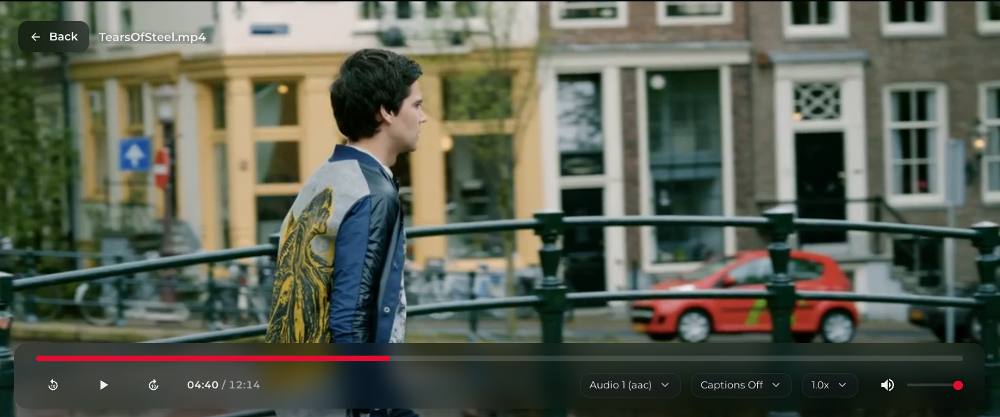
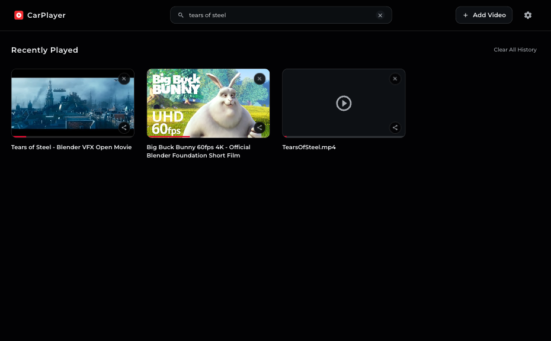
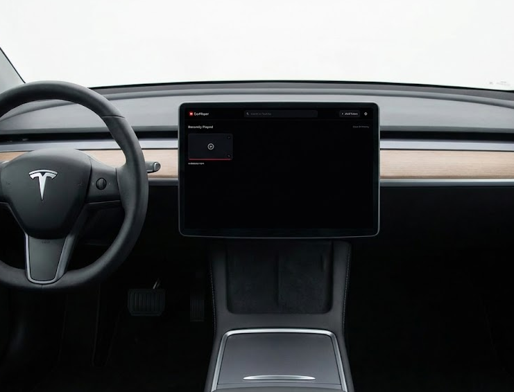

#  CarPlayer

A simple web video player that lets passengers, especially kids, watch videos while driving by bypassing standard in-car
entertainment restrictions.

> Disclaimer: Use responsibly. This project is intended for passengers only. The driver must stay focused on the road at
> all times.

## How to use in the car

1. Open your car's browser.
2. Go to: <https://carplayer.oxyconit.com/>.
3. Pick a tab in the dock at the bottom: Play link, Jellyfin, Tube, IPTV, Radio or Mirror screen.
4. Type the link or settings on the car screen, or scan the QR code with your phone and send them from there.
5. Watch or listen. The app keeps playing while the car is in Drive.

## Functions

### Dashboard

- Widgets: clock, weather, GPS speed, G-Force meter, calculator, todo list, Jellyfin rows and Favorites.

### Video

- Play direct video links (.mp4, .webm, HLS .m3u8, live streams), typed in or sent from your phone ("Play link").
- Play videos from your Jellyfin server and search its library; video codec and buffer are set in the Jellyfin tab.
- Tube: search and play videos through a CORS proxy you host yourself.
- Heart button in the player saves the current video to Favorites.
- Playback speed, captions, audio track and quality selection; live streams show a red "LIVE" badge.
- Resume where you left off, and recent history on the History tab.
- Dolby audio (AC-3 / E-AC-3) is converted in the browser as a last resort, when a stream has no other audio track.

### TV and radio

- IPTV: your own M3U playlist with a program guide (XMLTV) shown as a timeline in your local time zone.
  Mark channels with a heart and filter them with the Favorites chip.
- Radio: search the radio-browser.info directory, see the most popular stations worldwide, add your own stream links
  and keep them in "My stations". No stations are pre-added.

### Phone and car

- Send links and settings from your phone with a QR code, without typing long URLs in the car.
- Open link: send any web page from your phone and open it in the car browser.
- Mirror: show a laptop screen in the car.
- Move all settings between devices with "Move settings" on the About page.

## Relay backend (VPS)

QR code sharing sends small payloads through a short-lived HTTP relay session:

1. Car creates a relay session (`sessionId`, `readToken`, `writeToken`) with TTL.
2. QR contains only `sessionId` + `writeToken`.
3. Phone sends a payload (for example `video-url`, `jellyfin-config`, `iptv-config`, `radio-station`, `tube-config`,
   `redirect-url` or `settings-import`) to the relay.
4. Car polls relay and consumes queued payloads. The relay keeps them in memory only, for at most 180 seconds.

Why not P2P? It avoids LTE/hotspot NAT issues entirely because it is an HTTPS relay

### Deploy QR relay on your VPS (Docker Compose)

Start from project root: `docker compose up -d --build`

## Screenshots





## Development

We use vanilla HTML, CSS and JS files - we don't need any bundler or compiler.

### Installation

```bash
git clone git@github.com:KamilDzierbicki/carplayer.git
cd carplayer
```

### Run locally

### Option 1: Go Server (Recommended, required for sharing link via QR code) - 

```bash
go run main.go
```
*The app will be available at `http://localhost:8080/`. This runs both the static site and the relay backend.*

### Option 2: Any static server

Playback works with any static file server (for example `python3 -m http.server`), but QR code sharing needs the
relay from Option 1. Opening `index.html` straight from disk does not work, because browsers block ES modules on
`file://` pages.

## Limitations

- CORS must be enabled on media hosts (`Access-Control-Allow-Origin`).
- Browser must support WebCodecs + MediaSource for full functionality.
- Some videos needs your own CORS proxy, and some IPTV and EPG servers need one too.

## Contributing

Contributions are welcome.

The status of this project is POC. When I have time, I will rewrite it using a more modern approach.
I did a lot of testing and debugging, so a lot of dead code left.

1. Fork the repository.
2. Create a feature branch:`git checkout -b feature/my-change`
3. Make focused changes in small commits.
4. Run manual checks locally.
5. Open a Pull Request with:
    - what changed,
    - why it changed,
    - how it was tested (steps/screenshots/GIF if UI impact).

## License

This project is licensed under the MIT License.
